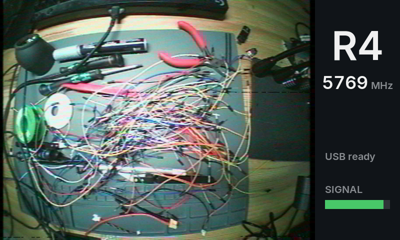

# 2026-11-16: channel and signal strip on the panel, and the UI simulator

## Question

Can the panel show the channel, frequency and a signal bar beside the picture at no cost to the 60 fps, and can the UI be developed in a browser without flashing?

## Setup

- Commit: the one that adds this note
- Boards: p4vrx (C5, Nano with `passthru_lockout_top`, P4) decoding R4

## Method

- The picture moved to the panel's left 630 columns, leaving a 170x480 strip on the right. The UI draws the strip in landscape into a PSRAM canvas, and the strip is copied into each of the three frame buffers once after it changes.
- Copy by CPU (a transposing loop), then by a PPA scale-rotate pass with the picture's rotation.
- `tools/lcdgrab.py` reads back the buffer last handed to the panel and saves it as a landscape PNG.
- The same UI C files compiled to WebAssembly and run in a page against fake state, with the dev server's rebuild time measured.

## Results

- CPU copy: 12.5 ms per buffer from PSRAM, and the panel fell to 41.4 fps.
- PPA copy: 3.0-3.5 ms per buffer, with the panel at 59.8 fps, video at 59.9 fps, demodulation on core 1 at 59.8% and drawing on core 0 at 42.2%.
- With the signal bar moved in tenths and a step-and-a-half hysteresis, the strip changed 28 times in the first 10 s (startup and lock) and then about once every 2 s.
- The grab matches the simulator's strip: 
- The simulator rebuilds in 0.8 s after a change to `ui/src/ui.c`, and the page reloads itself. Tapping the channel stepped R4, R5, R6.

## Verdict

Adopted: the strip through the PPA, and `ui/` as shared, hardware-free C with a browser simulator.

## Next

- Touch: the board's touch controller, so the tap works on the panel.
- The decoder reported gain 60 while the C5 reported 70 on one start, so the signal level read 10 dB high. This needs a look.
