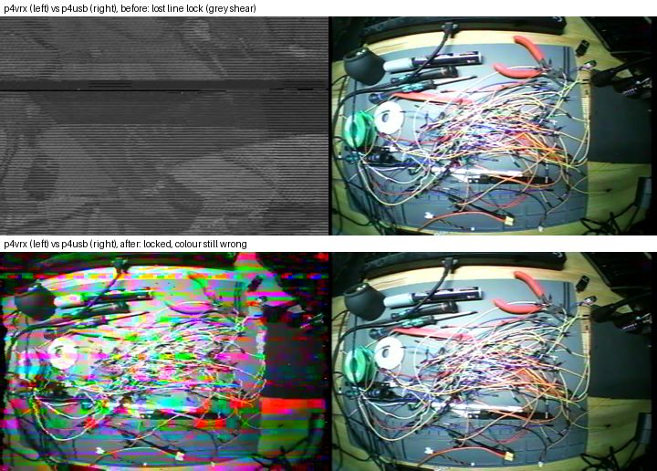

# 2026-11-16: overnight picture work, p4vrx against p4usb on R4

## Question

Why is the p4vrx picture bad next to p4usb on the same camera, and which of the grey-shear smears, FM clicks and colour can be fixed?

## Setup

- Commits: 51cc6638 (line period), d1fe0d9c (decode-rate clock placement), 95b50f4c (counter test), on top of the UVC port
- Bitstream: `passthru_top` in SRAM (`passthru_neg_top` for one test); `safe_top` in flash
- Boards: as before; p4usb's P4-Pico on the same desk as the reference, read only through its UVC stream (`~/.local/bin/camgrab`)
- Camera on R4 (5769 MHz)

## Method

Decoder lock and noise from `decode`, polled every 2 s for 45 min (`captures/soak/long.csv`), with both cameras grabbed every 5 min. Picture numbers from those grabs: luma noise as the mean of each pixel against its horizontal neighbours, chroma row jumps as the mean Cb/Cr change between rows, saturation as mean |Cb, Cr|. Raw I/Q captures at 1 in 6 for clock placement and line timing. `iq counter` for the lane timing through the Nano.

## Results

- Grey shear: the decoder's line period could walk to +0.5% on false hits and, as p4usb does, kept it across a loss of lock, so every re-acquisition drifted out of the window again. Now it resets on loss and stays within 0.3%. A 45-minute soak never lost lock: 1,298 samples, 218 to 254 of 262 hsyncs, mean 252.8, no event; before, lock went within minutes and stayed gone.
- Clock placement at the decode rate: at 1 in 6 the Nano's register samples the C5's bus at one of several places, measured as 1, 10 and 70 phase spikes per thousand samples, and the 40 MS/s probe's place did not carry over. `iq_start` now measures and slips until it finds the best: 5 of 6 starts lock with sync-tip noise 164-396 kHz, against 600-1030 kHz and frequent loss before.
- Clock placement by the decoder's own noise: even from a clean-looking capture place, decodes split into 150-400 kHz and 900-1000 kHz sessions. `decode on` now slips the clock while decoding until the sync-tip noise is near the lowest seen: 7 of 8 starts settled at 138-319 kHz (the 8th failed earlier in its start).
- Clicks over the soak: median 52 lines a field (p10 20, p90 58); 43-68 after the noise-based placement.
- The phase table's offset is not it: holding it anywhere from (0, 0) to (-8, 0) left clicks at 46-63 a field. The tracked offset wandered to (-37, -38) for under 1% of the soak.
- A resampling bitstream (`passthru_pll_top`: a PLL at 6x the C5 clock sampling every lane at one of 16 phases) gave 1-5 phase spikes per thousand at every phase, no better than the best direct place; its PLL input is not on a dedicated clock pin and its lock flickers.
- Against p4usb over 9 pairs of grabs: luma noise 2.9 against 2.3, chroma row jumps 13.5 against 3.9, saturation 36 against 16. The luma is close; the colour is not. Halving saturation halves the row jumps, so chroma is over-amplified, as if the burst reads weak.
- Counter test (C5 `link`, 7-bit counter on one lane group, 327,679 samples): Q lanes count perfectly through the Nano at 13 and 40 MHz, so the clock path adds no edges. I lanes fail on the same edge (317,437 bad steps at 13 MHz) and pass when the Nano registers on the falling edge instead. I and Q reach the Nano with different timing against the C5 clock. For real I/Q the falling edge is worse (best 4.5 spikes per thousand against 0.9-1.8).
- The camera's line period measured 0.2-0.7% long tonight against 0.0% earlier; the counter test rules out extra samples, so it is the camera.
- Not it: the H.264 encoder (decoder noise the same with it off), a GPIO glitch filter on PCLK, clicks handling (hold, gray, off).

## Verdict

Adopted: the line-period reset and clamp, and clock placement at the decode rate by the decoder's own noise; the grey shear is gone and starts are mostly good. Open: colour. After everything above, p4vrx still shows 2.3x p4usb's saturation and 3.6x its row-to-row chroma jumps with luma noise only 1.3x, unchanged by sync noise, offset, encoding or sampling phase. The rainbow sits on fine luma detail, which points at the chroma comb (two lines a pair, opposite subcarrier phase) not cancelling luma here, rather than at noise.

## Next

- Check the chroma comb's line pairing and the burst's line-to-line coherence in the decoder (dump per-line burst phase), against a raw capture analysed offline.
- Compare the decoder's burst magnitude with p4usb's on the same picture, if p4usb's console can be read.
- If sampling comes back into it: feed the PLL from a dedicated clock pin, or try Gowin's IODELAY per lane.

Update: the colour fault turned out to be spurious C5 clock edges from crosstalk on the C5-to-Nano jumper, fixed with `passthru_lockout_top`; see [PCLK extra edges](2026-11-16-pclk-extra-edges.md).
